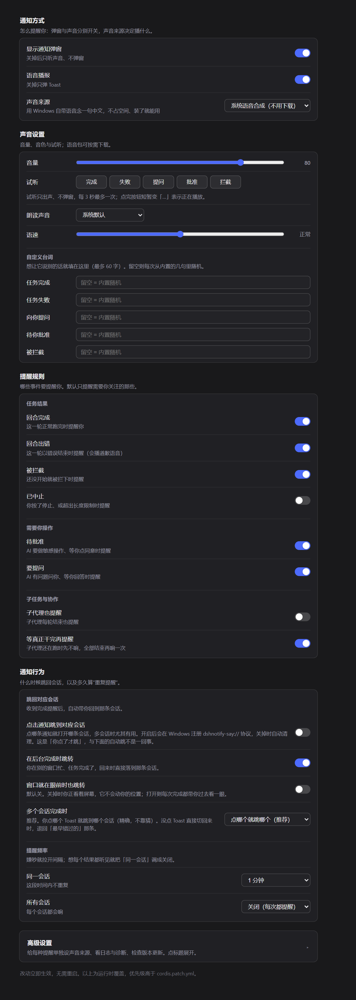

# dsh-notify-say

[](https://www.npmjs.com/package/dsh-notify-say)
[](https://www.npmjs.com/package/dsh-notify-say)
[](https://github.com/unifilitence/dsh-notify-say/actions/workflows/ci.yml)
[](https://github.com/unifilitence/dsh-notify-say)
[](#安装)
[](LICENSE)

给 [DeepSeek Harness](https://github.com/deepseek-ai) Desktop 用的语音通知插件：**任务跑完会说话**。

> 别的通知插件"叮"一声；这个会喊你"任务完成了"。
> 而且**子代理还在跑的时候，它不会骗你说完成了**。
>
> *Desktop notifications for DSH Desktop (Windows) that actually speak — Windows TTS out of the box, optional VOICEVOX / Chinese voice packs, and an idle gate that waits for running subagents before saying "done".*



> 设置页实拍（声音来源 = 系统语音合成）。语音包、提醒规则、高级区见下文。

---

## 目录

- [安装（30 秒上手）](#安装)
- [快速开始](#快速开始)
- [它解决什么问题](#它解决什么问题)
- [特性](#特性)
- [配置](#配置)
- [语音包](#语音包)
- [关于"跳回会话"](#关于跳回会话能做到什么做不到什么)
- [兼容性与降级](#兼容性与降级)
- [已知限制](#已知限制)
- [常见问题](#常见问题)
- [开发](#开发)
- [许可](#许可)

---

## 安装

### 前置

- **Windows**（Toast 用 WinRT，播放用 MCI，调用系统自带 Windows PowerShell 5.1，无需额外装 PS7）
- DSH Desktop **0.2.1-rc.2 ~ 0.3.0**（`>=0.2.1-rc.2 <0.3.0`）
  - 实测环境：`0.2.1-rc.2`、`0.2.1-rc.5`、**`0.2.2-rc.1`**（2026-11 最新）。更早版本**未测过**，所以没有声明支持
  - 设了上界 0.3.0：DSH 若有不兼容改动，市场会拦住而不是让你装了才发现

### 方式一：插件页（推荐，不用命令行）

1. 打开 DSH 的 **设置 → 插件**
2. 找到「**包名或地址**」输入框（不是上面那个搜索框 —— 那个只过滤已安装列表）
3. 填进去：

   ```
   dsh-notify-say
   ```

4. 点「**安装**」，装完重启 DSH

> 装的时候卡住或报网络错误？在同一个面板里把「**安装源**」切到「**中国大陆镜像源**」再试 —— 官方源在国内经常拉不动。
> 填 `dsh-notify-say` 是**包名**（不是搜索词）。它也能接受 GitHub 仓库地址或本机目录路径，但包名最简单。

<details>
<summary>方式二（npm）与方式三（本地源码 link 开发）</summary>

#### 方式二：npm

```
npm install dsh-notify-say
```

#### 方式三：手工 link（本地开发）

把本仓库目录链接进 profile：

```
D:\Program Files (x86)\DSH\profiles\desktop\package.json
  dependencies 里加:  "dsh-notify-say": "link:<本仓库路径>"
  dsh.profile.bundles 里加:  "dsh-notify-say"
```

然后在该 profile 目录执行 `pnpm install`，重启 DSH。

</details>

---

## 快速开始

装好之后**什么都不用配就能用**：任务完成时会弹 Toast + 播自带音色。

想做更多，进 **DSH 设置 → 通知**：

| 想做的事 | 去哪 |
|---|---|
| 换音色 / 调音量 | 设置页「音色」「音量」 |
| 下载更多音色（15 个可选） | 设置页「语音包」→ 点「加载列表」→ 选一个点「下载」 |
| 只保留提示音、不要语音 | 音源改成「系统提示音」 |
| 出错时也要语音提醒 | 「出错」开关（默认已开） |
| 让子代理结束也提醒 | 「子代理」开关（默认关） |
| 少响一点 | 「同会话去抖」调大 |
| 看看有没有新版 | 高级区「版本与更新」→ 检查更新 |

---

## 它解决什么问题

你让 AI 跑一个较长任务，然后切去干别的。常见两种通知插件的毛病：

1. **该响的时候不响** —— 主会话一轮结束就报"完成"，但其实它派出的子代理还在跑，你回来发现没干完。
2. **不该响的时候一直响** —— 每个子代理结束都弹一次，连环轰炸。

本插件的做法：

- **空闲门（idle gate）**：主会话这轮结束、但仍有子代理或后台任务在跑时，**先不播**；等全部结束再播**一次**。超时兜底（默认 10 分钟），防子任务卡死导致永不播报。
- **按会话去抖**：同一会话默认 60 秒内只响一次。
- **失败单独提醒**：回合出错时播**日语道歉语音**（可选）—— 比"任务完成"更该让你立刻知道。

---

## 特性

| 特性 | 说明 |
|---|---|
| **语音播报** | 播放本地 wav，**不调用云端 TTS**。发布版自带 2 个音色（1 日语 + 1 中文），另 15 个可在设置页按需下载 |
| **空闲门** | 有在飞工作时不误报"完成"，全部结束才播一次 |
| **五类事件** | 完成 / 出错 / 被拦截 / 待批准 / 要提问，各自独立开关 |
| **设置页 GUI** | 走官方 `Config` schema，在 DSH 设置页里直接改，**改完立即生效** |
| **命令行** | `tools/notify-config.ps1`，适合脚本化与排查 |
| **切回窗口时跳会话** | 通知时你不在前台 → 你切回来时自动跳到那个会话（见[下文](#关于跳回会话能做到什么做不到什么)） |
| **点哪条通知就跳哪条** | 多会话同时完成时，点不同的 Toast 会落到各自的会话（**可选开关**，见[下文](#-能做到点哪条-toast-就跳哪条v0470-起v0483-稳定)） |
| **不装语音也能用** | 没有语音包 = Toast + 系统提示音，这是正常配置 |
| **许可先告知** | 下载音色前弹出条款确认，写明署名要求与官方条款链接 |
| **诊断导出** | 一键导出脱敏日志（用户名/路径已替换），方便提 Issue |
| **日志隐私分级** | 默认只记元数据，**不记台词正文**；要详细日志需手动开 debug |
| **检查更新** | 显示当前/最新版本，有新版时给出升级命令（**不自动更新**，见[下文](#常见问题)） |

> **联网说明**：通知、播放、TTS **完全离线**。
> 会联网的只有两件事：
> 　① **下载语音包**（访问 GitHub，只有你点「下载」时才发生）
> 　② **检查更新**（访问 npm registry 与 GitHub，**每 24 小时最多一次**）
>
> 不想让它检查更新？不点「检查更新」就不会主动查；已缓存的 24 小时内也不会再查。
> 网络不可用时这两件事都会失败，但**不影响通知和语音**。

---

## 配置

四种来源，**优先级由低到高**（后者覆盖前者）：

```
1. schema 默认值
2. cordis.patch.yml 的 config
3. DSH 设置页里改的值
4. tools/notify-config.ps1 写的 storages/config.json
```

> ⚠️ **注意语义**：一旦你在设置页改过某项，再改 `cordis.patch.yml` 里同一项**不再生效**。
> 这是 DSH 官方设计（用户层优先级更高），不是本插件的 bug。

### 设置页

**DSH 设置 → 通知**。包含音源选择、语音语言、音色、音量、增益、TTS 参数、五个事件开关、
去抖与冷却、音源按事件覆盖、自定义音频、语音包管理、日志级别、诊断导出等。

分常规区与「高级」折叠区：日常只用常规区，排查时才展开高级区。

**语音语言**：日语音色和中文音色不混播。选「日本語」时随机模式只从日语音色里抽，
选「中文」时只从中文音色里抽，音色下拉也只列该语言的音色。切换语言会自动把固定音色
换到该语言的默认音色（中文 → 温柔女声，日语 → ずんだもん），避免出现
「语言=中文、固定音色=ずんだもん」这种会直接落空的组合。

从旧版本升级、且之前已经把音色设成中文的用户，不需要手动改语言：插件会按你现有的
音色自动归到「中文」（依据是音色名以 `zh-` 开头）。这条只在你的配置里**没有**语音
语言这个键时生效 —— 自己显式选过的语言永远不会被覆盖。

<details>
<summary>命令行配置（<code>tools/notify-config.ps1</code>，适合脚本化与排查）</summary>

```powershell
cd <插件目录>\tools

.\notify-config.ps1 -Show              # 看当前生效值
.\notify-config.ps1 -Voice off         # 静音（Toast 仍弹）
.\notify-config.ps1 -Volume 40
.\notify-config.ps1 -VoiceMode random
.\notify-config.ps1 -VoiceName ankomon
.\notify-config.ps1 -Disable aborted -Enable subagents
.\notify-config.ps1 -Clear             # 交还控制权给设置页
```

改完**立即生效**，不需要重启 DSH。

**PowerShell 版本**：这些命令用 Windows 自带的 PowerShell 5.1 就行，**不需要装
PowerShell 7**。如果你装了 7，用 `pwsh` 跑也一样。插件的所有脚本都按 5.1 兼容维护 ——
本插件的运行本来就依赖 5.1（Toast 通知走 WinRT，只有 5.1 有），所以不会出现
「装了插件还得额外装个 PowerShell 7」的情况。

</details>

---

## 语音包

核心包自带**两个音色**：一个日语（ずんだもん）+ 一个中文（温柔女声），安装包约 4 MB。

为什么带两个而不是只带一个：中日两种台词都在包里（中文台词是给系统语音合成用的），
只带日语音色的话，中文用户听到的是**日语腔念中文**。带一个中文的，中文用户开箱就有可用声音；
想要别的音色再下载。

另有 **15 个音色**可单独下载（12 个日语 + 3 个中文，每个约 1.0–3.0 MB，合计约 27.6 MB），
**在设置页里点几下就能装**，不需要命令行。

### 中文音色

| 音色 | 说明 |
|---|---|
| 温柔女声 · 中文 | 自带，声音最宽厚 |
| 清亮女声 · 中文 | 可下载 |
| 平稳男声 · 中文 | 可下载 |
| 低沉男声 · 中文 | 可下载 |

中文音色由 **EmotiVoice** 合成（网易有道开源，Apache-2.0），与日语的 VOICEVOX 音色
在分发机制上完全一样：打包、下载、卸载、条款确认走同一套代码。

中文音色每个有 **12 条台词**（日语 VOICEVOX 音色每个 15 条），覆盖完成、出错、等待回答、
等待批准四种场景，每条按场景配了不同的语气（出错时会放低，完成时轻快）。

### 怎么装

1. **DSH 设置 → 通知 → 语音包** → 点「加载列表」
2. 列表里会显示每个音色的名称、体积、署名要求
3. 点「下载」→ **先弹出条款确认弹窗**（见下）→ 确认后开始下载
4. 装好后在「音色」下拉里就能选到

### 下载前会告知什么

点下载会弹一个居中弹窗，写明：

- **署名要求**（例如 `VOICEVOX:ずんだもん`）—— 你用这些语音做的内容需要保留这个署名
- **官方条款链接**（可点开原文）
- 提示"下载后 zip 内也带 TERMS.md；你用它做的内容（视频、直播等）仍需守上述条款"

这不是走形式：我们逐条读过 **16 个** VOICEVOX 日语音色的官方条款，其中 2 个因为明文
**禁止再分发**被排除在外，1 个因为身份存疑（同名角色有多个）暂不收录，其余 13 个可发布。
审核依据是官方条款原文，留档在 [`docs/audio-audit/`](docs/audio-audit/)。

> 需要说清楚：我们的审核结论是**依据官方通用条款**得出的，
> 不等于各权利人针对"独立 WAV 素材 ZIP 再分发"出具过专项授权。

### 卸载

设置页里点「卸载」即可，会删掉该音色整个目录。
**卸载不依赖网络** —— 离线时也能卸。

### 已装的音色放哪

```
%LOCALAPPDATA%\dsh-notify-say\voice-lines\<音色key>\
```

每个音色一个目录，卸载 = 删这一个目录。

### 不装语音包也完全可用

通知会退回 Windows Toast + 系统提示音。

### 想自己做音色

装 [VOICEVOX](https://voicevox.hiroshiba.jp/)（本地免费 TTS），启动引擎（默认 `http://127.0.0.1:50021`），
然后按命名规则把合成好的 wav 放进对应目录：

```
sounds/voice-lines/<key>~1.wav            完成
sounds/voice-lines/question/<key>~1.wav   提问
sounds/voice-lines/approval/<key>~1.wav   审批
sounds/voice-lines/fail/<key>~1.wav       出错
```

（合成脚本不随本包发布 —— 它依赖本地 VOICEVOX 引擎与特定音色表，放进发布包只会误导。）

---

## 关于"跳回会话"：能做到什么，做不到什么

这一节把边界写清楚 —— 有些事是**宿主没给接口**，不是本插件偷懒。
结论先给：**默认能在你切回窗口时跳到「离开期间最早完成」的会话；打开显式开关后，也能做到「点哪条 Toast 就跳哪条」。**

### ✅ 能做到：切回窗口时跳到那个会话

```
通知发出时你不在前台  →  插件记下那个会话
你切回 DSH 窗口       →  插件自动跳到它
```

所以体验是：你在别处干活 → 听到"任务完成了" → 切回 DSH → **它已经帮你跳过去了**。

相关开关（默认值偏保守）：

| 开关 | 默认 | 说明 |
|---|---|---|
| 后台完成时跳转 | 开 | 通知时你不在前台 → 切回来时跳 |
| 前台完成时也跳 | 关 | 你正看着屏幕时也带你过去（v0.4.63 起真正生效，见下） |
| 多个会话完成时 | 跳到最早错过的 | 见下节 |

配置读不到时**两个开关都当作关**（宁可少跳一次，也不擅自动你的界面）。

### 前台完成怎么做到「立刻跳」

打开「前台完成时也跳」后，插件用**长轮询**盯着新信号：

```
窗口可见 → 客户端挂一个 GET /wait?after=<已知最新>
         → 服务端没新信号就**挂着不返回**（不占 CPU、不发新请求）
         → 一旦有完成信号，立刻返回 → 客户端立刻跳
```

所以是**信号一到就跳**，不存在「声音响了一会儿才跳过去」的延迟。
窗口一隐藏，长轮询立刻停止，改由下面的「切回来时跳」接手 —— 两者不会重复跳。

> 实现细节：为什么不用定时轮询 —— 定时轮询要么延迟明显（体验割裂），
> 要么空转（每秒几次请求）。长轮询两头都不占。

### 多个会话都完成时跳哪个

这是个真问题：你离开期间 A、B 先后完成，回来只跳一个，另一个就只能靠侧栏绿点。

默认规则是**跳到最早错过的那个**。理由是：你回来时界面通常仍停在它上面，
对它 `openSession` 等于无操作 —— 于是你正在看的会话**不被打断**，
而你最先错过的那个正好被带过去。其余的留着绿点，你一个个看。

| 选项 | 行为 |
|---|---|
| **跳到最早错过的**（默认） | 见上。多为你仍停在它上面，等于不打断 |
| 跳到最后一个 | 只在最后完成的那条落脚 |
| 都不跳 | 多个完成时不跳，侧栏绿点一个个自己点（单会话时照常跳） |

### ✅ 能做到：点哪条 Toast 就跳哪条（v0.4.70 起，v0.4.83 稳定）

> **这一节曾经写的是「做不到」。** 2026-10-20 我们做出了可靠实现，
> 旧结论已推翻，下面说明它是怎么做到的、以及怎么开启。

**先说限制**：DSH 桌面壳层对 `dsh://open` 做精确匹配 ——

```js
app.on("open-url", (event, url) => {
  event.preventDefault();
  if (url === "dsh://open" || url === "dsh://open/") focusPrimaryWindow();
});
```

只有这两个精确字符串会唤窗，**带任何参数连窗口都唤不起来**。
所以这条限制到今天依然成立：**不能靠 DSH 自己的协议传递会话 id。**

**绕开它的办法：注册我们自己的协议 `dshnotify-say://`。**

```
你点 Toast
  → Windows 按 HKCU 注册表调起处理器（wscript + jump-handler.vbs）
  → 处理器把 session id POST 给插件的本地端点 /pending-jump
  → DSH 前端读到后调用 uiWorkspace.openSession()
  → 落到你点的那条通知对应的会话
```

三个关键点：

| 关注点 | 做法 |
|---|---|
| **不弹黑窗口** | 处理器用 `wscript.exe`（GUI 子系统，不创建控制台），不是 `powershell.exe` |
| **端口每次都会变** | 插件把当前端口写进 `%LOCALAPPDATA%\dsh-notify-say\port.txt`，处理器读它 |
| **只有点了才跳** | 开启此功能后，旧的「切回窗口自动跳」会被**关掉**，避免抢跳 |

**怎么开启**：设置页 →「通知」→ 打开 **「点击通知跳转到对应会话」**。
开启时会注册 Windows 自定义协议（仅 `HKCU`，不需要管理员，随时可关）。

**不开启时**：点 Toast 仍然是原来的行为 —— 把 DSH 窗口唤到前台，不跳会话。
不存在「装了就自动具备」这回事，这是一个显式开关。

**相关代价（如实说明）**：
- 首次点击会比平时多几十毫秒（要拉起处理器进程）
- 处理器若被安全软件拦截，会退化成「只唤窗不跳转」，不会更糟
- 开关关闭时会删掉注册表项，不留垃圾

**卸载插件后它会怎么清理？**

Windows 自定义协议只能在插件**被加载时**注册/清理，而 DSH 官方
不提供「插件被卸载」的独立事件 —— 升级、卸载、热重载走的是同一条
移除路径（源码 `dsh-plugin-manager` 明确写着这一点）。
所以**不能在插件退出时删注册表**，否则会把热重载后的注册误删。

改用一条**只清失效项**的规则：插件每次启动时检查旧注册 ——

| 旧注册指向 | 判定 | 行为 |
|---|---|---|
| **带本插件身份标记**（`DSHNotifyOwner`），文件还在 | 正常 | 不动它（不重写注册表） |
| 带本插件标记，**文件已不存在** | 失效 | **清掉**（这就是卸载后的尾巴） |
| 没有标记、也没有本插件的处理器文件名 | 别人的 | **绝不动**，自己降级成只唤窗 |

判据是「身份标记 + 文件不存在」，热重载/升级/正常运行时它永远为假，
**所以不会误删**。实测四种情形均符合预期（有测试锁定）。

> **为什么用「身份标记」而不是「插件目录」**
>
> 早期版本靠比对插件目录判断归属。这在插件**改名/换路径**之后会永久坏掉：
> 旧注册的路径与新目录对不上 → 判成「别人的」→ 既不清理也不重建 →
> 精准跳转悄无声息地退化为「只唤窗」，用户关掉再打开开关也修不好。
>
> 现在注册时会在注册表键里写一个 `DSHNotifyOwner = dsh-notify-say` 标记，
> 目录怎么搬都认得出是自己写的（v0.5.0 起）。

> **如果你卸载了插件、想立刻清掉注册表**（不等下次启动 DSH）：
>
> ```powershell
> Remove-Item 'HKCU:\Software\Classes\dshnotify-say' -Recurse -Force
> ```
>
> 只删这一个键，不影响任何其他程序。v0.5.0 之前的旧键 `dshnotify` 会在插件
> 下次启动时自动清理。

### ❌ 做不到：知道「你现在正看着哪个会话」

插件拿不到这个信息，四条路都堵着：

| 想用的手段 | 实际情况 |
|---|---|
| `uiWorkspace` 服务 | 只提供 `openSession` / `startSession` / `openWorkspace` —— **只写不读** |
| 会话切换事件 | 插件能订阅的是 `session/event` / `agent/status` / `approval/request`，**没有「切换/激活」** |
| URL 路由 | DSH 不用 URL 承载会话 id |
| 宿主内部状态 | 宿主**确实知道**（`SessionUpdateRouter.activeSessions` 记录着哪些会话正被订阅），但那是 client 传输层内部结构，**没有对插件开放** |

所以插件无法判断"要跳的就是你正看着的那个"。
上面那条「跳到最早错过的」规则，正是因为缺这个信息才采用的**间接办法** ——
它靠"跳到同一个会话等于没跳"来达到相近效果。

如果将来 DSH 开放"当前会话"读取，这里可以换成精确判断。

### ❌ 做不到：把绿点加回去

宿主没有"标记未读"的接口（整个 `app.asar` 里搜 `unread` 只命中一个 SVG 图标文件名）。
插件只能**观察**会话状态，不能写回。
所以"跳走之后把原来那条重新标成未读"做不到 —— 这也是默认规则选
「跳到最早错过的」的原因：从源头上避免把你从该看的会话上带走。

### ✅ 能做到：Toast 告诉你是哪个会话

既然跳不过去，至少让标题说清是谁。Toast 标题用**会话标题**（DSH 侧栏显示的那个，
通常是你第一句话的摘要），例如：

```
┌────────────────────────────────────┐
│ 优化 Deepseek Harness 配置与插件      │
│ ✅ 任务完成 · 回来看结果吧            │
│ 0Deepseek                          │
└────────────────────────────────────┘
```

- 标题来源三级：`sessionTitle` 服务 → `sessionProjections` 的 `title` 投影 → 会话 id 前 12 位。
  前两级都拿不到时**退回通用文案**（不会把会话 id 当标题显示）。
- 第三行是**项目名**（工作目录最后一段），只在**标题里没包含它**时才显示，
  避免单项目用户看到重复信息。

> 为什么拿不到"会话内容摘要"：插件订阅的 `turn/end` 事件只带 `{ turn, reason }`，
> 没有消息正文；投影缓存里也只有标题、没有正文预览。标题本身已是首句摘要，
> 已经是现有接口下最有信息量的选择。

## 兼容性与降级

本插件的首要目标是**稳定**，所以每个依赖外部能力的地方都有降级路径：

| 能力 | 拿不到时怎么办 |
|---|---|
| `@deepseek-ai/schemastery`（生成设置页） | 不导出 `Config` → **设置页不出现，插件照常工作** |
| `uiWorkspace.openSession`（跳会话） | 不跳转，Toast 仍能唤出窗口（**退回旧行为**） |
| 语音包目录 | 回退系统提示音 |
| 网络（下载语音包时） | 显示失败原因并可重试；**已装音色不受影响** |
| `$DSH_HOME` 未设置 | **不是降级**：按官方同款规则回落到 `~/.dsh`（见下） |
| 连 `~/.dsh` 都取不到（`homedir()` 失败等极端情况） | 配置走 patch 默认值；不写任何状态文件 |

> **关于 `$DSH_HOME`（v0.4.88 修正）**
>
> `$DSH_HOME` 是**可选覆盖项**，官方 DSH 的解析优先级是
> **显式配置 > `$DSH_HOME` > `~/.dsh`**。绝大多数用户机器上并没有设置这个环境变量。
>
> v0.4.87 及更早版本只读 `process.env.DSH_HOME`，没值即返回空串，于是设置页
> 任何保存都返回 `保存失败：no-home`（连「声音来源」都切不了）——
> 这是**真 bug，不是降级**。v0.4.88 起改为与官方同一套规则：
> `$DSH_HOME`（空白视为未设置）→ `~/.dsh`，并优先尝试直接调用官方
> `@deepseek-ai/dsh-home-paths` 模块（拿不到时才复刻规则）。
>
> 注意：如果你的机器**显式设置了** `$DSH_HOME`（本机开发环境就是如此，
> `D:\Program Files (x86)\DSH`），配置文件仍落在 `$DSH_HOME` 下，行为不变。


**不会出现"静默失效"**：每个降级都有明确行为，并有测试锁定。

---

## 已知限制

- **仅 Windows**（Toast = WinRT，播放 = MCI，调用 Windows PowerShell 5.1）
- **跳会话依赖未文档化 API**（`uiWorkspace`），官方随时可能改；坏了会自动降级为"只唤起窗口"
- `blocked`（回合被拦截）只用系统蜂鸣，不播失败语音 —— 语义是"被拦下"而非"失败"
- **失败语音只覆盖部分音色**：选到未覆盖的音色时，会在同池内换一个音色播，不会哑掉、也不会播错语义
- **自重载是实验性功能，而且只有"点一次"**：设置页「高级设置 → 开发者选项」里有个
  「重载现在生效」按钮，点一下尝试一次；**没有开关、不会自动监听文件**。
  
  为什么改成这样：2026-10-18 实测「监听文件自动重载」会把宿主拖崩 —— 一次改 UI 期间
  触发了 40 多次失败重载，每次销毁实例都会释放宿主仍在用的会话引用，最后渲染进程崩溃。
  危险的不是"重载失败"，是"**反复**重载"
- **自重载不能替代重启**：它只能重新导入「同一路径上的」代码。用 `dsh plugin update`
  升级后，新版本装在 `.pnpm/<name>@<ver>/` 另一个路径，自重载做不到 —— 必须重启 DSH
- **日语 13 个、中文 4 个音色的许可结论是条件性判断**（依据官方通用条款），不代表各权利人出具过专项授权

---

## 常见问题

**装了没声音？**
按顺序查：① 设置页「音源」是不是「不发声」；② 「语音」开关是否关着；
③ 「音量」是否拉到 0；④ 播放依赖 Windows PowerShell 5.1，被安全软件拦了会静音。
设置页「诊断」区可以**导出脱敏诊断文件**，里面能看出每次播报的决策路径，
还会写明 DSH 目录是从哪来的（`$DSH_HOME` 还是 `~/.dsh`）以及配置文件当前在不在 —— 「设置改了保存不了」几乎都是这一类问题。

**会不会打扰我？**
默认同会话 60 秒只响一次；「子代理」默认关（子代理结束不单独提醒）。
觉得吵可以把「同会话去抖」调大，或直接关掉某类事件。

**会上传我的会话内容吗？**
不会。通知文案是插件内置的固定句子（可自定义），播放也全在本地。
默认日志只记"播了什么、成功与否"，**不记台词正文**。
会联网的只有两处：下载语音包、以及每 24 小时最多一次的检查更新。二者失败都不影响通知与语音。

**提示"未能获取可下载列表"？**
那是 GitHub 访问不通。**已装的音色照常能用**，卸载也能用（卸载不依赖网络）。
网络恢复后点「重试」即可。

**为什么只有这么几个音色？**
日语方面 VOICEVOX 有几十个角色，但每个的条款都要单独读原文核对。
我们只收录**条款明确允许本插件这样分发**的，宁可少也不冒险。
被排除的例子：有 2 个明确禁止再分发，1 个身份存疑。

中文音色是另一条线：由 EmotiVoice（Apache-2.0）合成，训练语料 LibriTTS / HiFiTTS
都是 CC BY 4.0。我们只做了 4 个，因为再多就得逐个试听、逐句核对发音 ——
中文口语里的多音字、儿化音比日语更容易念错。

**有新版本了怎么办？**

设置页 → 高级 → **版本与更新** → 点「检查更新」。有新版时那里会显示版本号、
`CHANGELOG.md` 链接，以及一条升级命令（可一键复制）。

**插件不会自己更新自己。** 原因很实在：

- 装上你的机器后，插件不知道自己是通过 npm、GitHub 还是 `link:` 装的
- 正在运行的程序替换自己的文件，失败后很难恢复
- DSH 官方 CLI 已经能升级插件（`dsh plugin --profile <名字> update dsh-notify-say`）—— 重复实现没意义

所以分工是：**插件负责告诉你有新版；你执行命令；DSH 完成升级。**
更新后需要重启对应的 DSH profile。

> 如果你是从源码 `link:` 安装的（开发模式），插件会认出来并**不给命令** ——
> 那种情况请直接更新源码目录，用插件命令会覆盖你的源码。

**能加我喜欢的音色吗？**
可以提 Issue。但要走审核流程（读官方条款原文、留档），不是加个下载链接的事。

---

## 开发

<details>
<summary>展开查看：跑测试（694 条）、测试分层、CI 与发版流程</summary>

### 跑测试

```powershell
npm test              # 主套件（纯 Node，不需要 DSH 宿主）
npm run test:all      # 全部（含 route 注入的两组）
npm run test:route    # 需要 --import loader 的接线测试
npm run test:audio-wire
```

**705 条测试通过**（`test:all` 两段实测：主套件 651 = 615 passed + 36 skipped 需真实宿主；
route 注入段 54 = 53 passed + 1 skipped）。
绝大多数是纯逻辑测试，克隆仓库后 `npm test` 即可跑。

少数用例需要真实的 DSH 宿主（用于验证 Cordis 上下文行为）。
找不到宿主时它们会**自动 skip** —— 注意 skip 不等于通过。

```powershell
$env:DSH_CORDIS_ENTRY = "<DSH 安装目录>\.runtime\node_modules\@deepseek-ai\cordis\lib\index.js"
npm test
```

### 测试分层

| 层次 | 内容 |
|---|---|
| 单元 | 音源选择、空闲门、配置校验、TTS 文案、http-guard 判定 |
| 集成 | 真实 HTTP 服务器 + 真实 handler，覆盖请求/响应全链路 |
| 行为 | 构造真实输入验证行为（如真实 ZIP 字节、真实目录） |
| 实机 | 真实 Cordis 上下文（需宿主，无则 skip） |
| 发布 | 构建发布包并断言被禁音色/第三方素材未进包 |

### 为什么有这么多"防复发"测试

这个项目踩过的坑多数是同一类：**代码看着对、测试也绿，但两者一起错**。所以后来改成：

- **构造真实输入**而不是检查源码里有没有某个字符串
  （典型：ZIP 解压防护查了不存在的字段 `entry.size`，测试也在断言同一个错字段 → 一起绿）
- **状态更新全量扫描**而不是逐个手查
  （典型：组件状态漏字段已发生 4 次，现在有 C43 静态扫描锁住）
- **变异验证**：故意改坏代码，确认测试真的会红

### CI

`.github/workflows/ci.yml` 在每次 push / PR 时跑：

- 单元测试（Node 20 / 22 / 24）
- PowerShell 语法与 UTF-8 BOM 检查
- 关键文件齐全 + npm 打包内容检查（含"被禁音色不得进包"）
- 版本一致性

### 发版

```powershell
.\tools\release.ps1 -Bump patch -PublishNpm
```

流程：升版本 → 跑测试 → 重建发布包 → **在发布包里再跑一次测试**
（这一步是必要的：开发目录与发布包的文件集不同，只在开发目录跑会"本地绿、线上红"）
→ 提交推送 → 可选发 npm。

`CHANGELOG.md` 由 `release-build.ps1` **自动生成**（从开发提交提取标题，
过滤掉内部资料与 hash），随包发布。**请勿手工编辑**。

</details>

---

## 许可

代码以 MIT 发布。

**语音文件不适用 MIT**：日语语音由 VOICEVOX 生成、中文语音由 EmotiVoice 生成，
各音色有其自身使用条款，详见 [`THIRD-PARTY-NOTICES.md`](THIRD-PARTY-NOTICES.md)。
每个音色包内另有该音色的 `TERMS.md`。
